<picture>
  <source media="(max-width: 600px)" srcset="./assets/banner-mobile.svg">
  
</picture>

## About Me

Hi, I'm Kaius 👋

Computer Science @ University of Waterloo

## Technical Stack

**Languages:** C, C++, Python, Rust, Go, TypeScript, Java

**Cloud / Infrastructure:** AWS, Kubernetes, Docker, Terraform

## Connect

**Portfolio:** [kaiusjin.com](https://kaiusjin.com)

**LinkedIn:** [linkedin.com/in/kaixuan-jin](https://linkedin.com/in/kaixuan-jin)

**Email:** [k39jin@uwaterloo.ca](mailto:k39jin@uwaterloo.ca)
