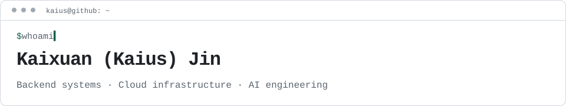

<picture>
  <source media="(prefers-color-scheme: dark)" srcset="./assets/banner-dark.svg">
  <source media="(prefers-color-scheme: light)" srcset="./assets/banner-light.svg">
  
</picture>

## About Me

Hi, I'm Kaius 👋

Computer Science @ University of Waterloo

I'm interested in **backend engineering, AI infrastructure, and platform & infrastructure engineering**. I enjoy building reliable, scalable systems and turning complex ideas into practical solutions.

## Technical Stack

**Languages:** C, C++, Python, Rust, TypeScript, Java

**Backend:** Spring Boot, PostgreSQL, MySQL, Redis

**Cloud / Infrastructure:** AWS, Kubernetes, Docker, Terraform

## Connect

**Portfolio:** [kaiusjin.com](https://kaiusjin.com)

**LinkedIn:** [linkedin.com/in/kaixuan-jin](https://linkedin.com/in/kaixuan-jin)

**Email:** [k39jin@uwaterloo.ca](mailto:k39jin@uwaterloo.ca)
